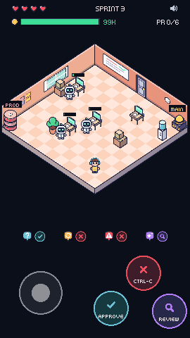

# Herd the Agents

A tiny top-down action roguelike about agentic engineering. You are the engineer; your coding
agents are supposed to merge PRs. They will not make it easy.

**Play it: https://matf.github.io/herd-the-agents/** (phone or computer)

 


## How to play

Every sprint is one random room. Your agents walk to their desks and work; each finished PR counts.
Merge enough PRs and the door opens. Walk through it, pick one of three upgrades, and the next,
harder sprint starts. The run ends when the token budget is burned or your hearts are gone.

Agents derail in four ways:

| Agent | What it does | What you do |
| --- | --- | --- |
| **Asks permission** (blue) | Stands there and waits | Walk into it to approve |
| **Loops** (amber) | Spins and burns tokens five times as fast | Ctrl-C it |
| **Hallucinates** (purple) | Wanders off and makes bugs that chase you | Ctrl-C it, squash the bugs |
| **Goes rogue** (red) | Runs for the prod database or the main branch | Ctrl-C it before it gets there |

A bug bite or an incident costs a heart. Every working agent burns tokens; merged PRs earn some back.

|  | Phone | Computer |
| --- | --- | --- |
| Walk | Left thumb, anywhere on the left half | WASD or arrow keys |
| Ctrl-C | Tap anywhere on the right half | Space (or J, Enter) |
| Upgrades | Tap a card | 1, 2, 3 |

On a phone, hold it upright. "Add to Home Screen" gives you full screen.

## Run it yourself

```sh
npm install
npm run dev      # http://localhost:5173
npm run build    # the finished game ends up in dist/
```

Every push to `main` is built and published to GitHub Pages by `.github/workflows/pages.yml`.

## Where things are

- `index.html`, `src/style.css` – the page around the game
- `src/main.js` – starts Phaser
- `src/view.js` – screen size, colours, text and button helpers
- `src/tiles.js` – which picture in the sprite sheet is what
- `src/run.js` – the state of one run and how hard each sprint is
- `src/room.js` – random rooms and path finding
- `src/upgrades.js` – the upgrades
- `src/objects/` – `Player`, `Agent`, `Bug`, `TouchPad` (the phone controls)
- `src/scenes/` – `PreloadScene`, `TitleScene`, `GameScene`, `UIScene` (the HUD), `UpgradeScene`, `GameOverScene`
- `src/sound.js` – sound effects, synthesized with the Web Audio API
- `public/assets/` – the sprite sheet, fonts and icons

Built with [Phaser 4](https://phaser.io) and [Vite](https://vite.dev), in plain JavaScript.

## How it was made

This game was built by a coding agent (Claude Code) in one sitting at the
Agentic Engineering Days in Zurich on 20 November 2026,
while its human sat in the talks. The human picked the idea and answered a handful of questions
about the gameplay; the agent wrote the code, chose the art, play-tested with a bot and deployed it.

## Credits

- Sprites: [1-Bit Pack](https://kenney.nl/assets/1-bit-pack) by Kenney, CC0
- Font: KenPixel from [Kenney Fonts](https://kenney.nl/assets/kenney-fonts), CC0 (re-saved as WOFF2 with a
  repaired character table, because browsers reject the original files)
