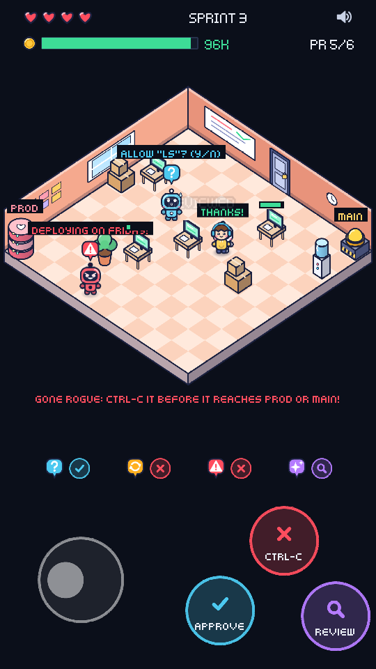

# Herd the Agents

A tiny isometric action roguelike about agentic engineering. You are the engineer; your coding
agents are supposed to merge PRs. They will not make it easy.

**Play it: https://matf.github.io/herd-the-agents/** (phone or computer)

 


## How to play

Every sprint is one random office. Your agents walk to their desks and work; each finished PR counts.
Merge enough PRs and the door opens. Walk through it, pick one of three upgrades, and the next,
harder sprint starts. The run ends when the token budget is burned or your hearts are gone.

You have three actions, and every way an agent derails needs the right one:

| Agent | What it does | What you do |
| --- | --- | --- |
| **Asks permission** (blue) | Stands there and waits | **Approve** |
| **Loops** (amber) | Spins and burns tokens five times as fast | **Ctrl-C** |
| **Hallucinates** (purple) | Wanders off and makes bugs that chase you | **Review** it, and review the bugs to squash them |
| **Goes rogue** (red) | Runs for the prod database or the main branch | **Ctrl-C** it before it gets there |

The wrong action makes it worse: Ctrl-C on a permission prompt or a hallucination throws the PR away,
approving a loop burns tokens, approving a hallucination makes one more bug, approving a rogue agent
makes it faster, and Ctrl-C next to an agent that is just working interrupts it.

A bug bite or an incident costs a heart. Every working agent burns tokens; merged PRs earn some back.

Power-ups turn up on the floor for a few seconds. Walk over them:

| Power-up | What you get |
| --- | --- |
| **Coffee** | You walk much faster for a while |
| **Token pack** | +15k tokens |
| **AGENTS.md** | Every agent is back on task and stays there for a while |
| **Rubber duck** | Every bug in the room is gone |
| **Day off** | One heart back |

|  | Phone | Computer |
| --- | --- | --- |
| Walk | Left thumb, anywhere on the left half | WASD or arrow keys |
| Approve | Blue button | J (or Z, 1) |
| Ctrl-C | Red button | K (or X, 2, Space) |
| Review | Purple button | L (or C, 3) |
| Upgrades | Tap a card | 1, 2, 3 |

On a phone, hold it upright. "Add to Home Screen" gives you full screen.

## Run it yourself

```sh
npm install
npm run dev      # http://localhost:5173
npm run build    # the finished game ends up in dist/
```

Every push to `main` is built and published to GitHub Pages by `.github/workflows/pages.yml`.

## Where things are

- `index.html`, `src/style.css` – the page around the game
- `src/main.js` – starts Phaser
- `src/view.js` – screen size, colours, text and button helpers
- `src/iso.js` – turns the square room grid into the isometric picture
- `src/art.js` – all the pictures, drawn in code
- `src/run.js` – the state of one run and how hard each sprint is
- `src/room.js` – random rooms and path finding
- `src/actions.js` – the three actions and which misbehaviour needs which
- `src/upgrades.js` – the upgrades between sprints
- `src/pickups.js` – the power-ups on the floor
- `src/tiles.js` – the icons on the upgrade cards (from the sprite sheet)
- `src/objects/` – `Player`, `Agent`, `Bug`, `Pickup`, `TouchPad` (the phone controls)
- `src/scenes/` – `PreloadScene`, `TitleScene`, `GameScene`, `UIScene` (the HUD), `UpgradeScene`, `GameOverScene`
- `src/sound.js` – sound effects, synthesized with the Web Audio API
- `public/assets/` – fonts, icons and the sprite sheet for the upgrade icons

Built with [Phaser 4](https://phaser.io) and [Vite](https://vite.dev), in plain JavaScript.

## How it was made

This game was built by a coding agent (Claude Code) in one sitting at the
Agentic Engineering Days in Zurich on 20 November 2026,
while its human sat in the talks. The human picked the idea and answered a handful of questions
about the gameplay; the agent wrote the code, drew the art (in code), play-tested with bots and deployed it. Halfway
through the human asked for cuter isometric graphics, three actions and power-ups, so those were added.

## Credits

- Characters, furniture and rooms: drawn in code (`src/art.js`)
- Upgrade icons: [1-Bit Pack](https://kenney.nl/assets/1-bit-pack) by Kenney, CC0
- Font: KenPixel from [Kenney Fonts](https://kenney.nl/assets/kenney-fonts), CC0 (re-saved as WOFF2 with a
  repaired character table, because browsers reject the original files)
